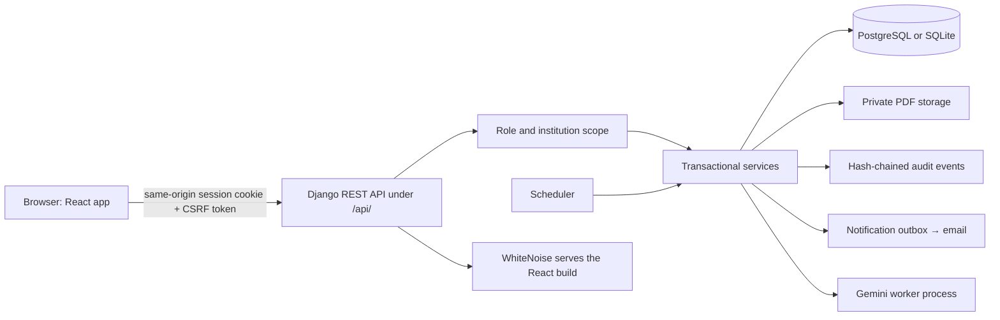

# Pramaan — Trust Backed by Evidence

**Security deposit and FDR portal for the AICTE Regulation Bureau** (Smart India Hackathon 2026, problem statement 26265).

Pramaan tracks the security deposits that technical institutions lodge with AICTE, from the first submission to the
final release. Every deposit is recorded with its documents, checked, reviewed by an officer, monitored until maturity,
renewed or released, and every step leaves a tamper-evident audit trail.

> **Synthetic data only.** The portal runs on fictional institutions and fictional documents. Anything that stands in
> for an outside system (bank statements, bank confirmations, the AICTE institution list) is labelled **SIMULATED**
> in the data and on screen. *Accepted* always means **accepted for tracking**. It does not mean verified by the
> bank, and it is not a statement of regulatory compliance.

---

## Contents

1. [What the portal does](#1-what-the-portal-does)
2. [Roles and what each can do](#2-roles-and-what-each-can-do)
3. [Architecture](#3-architecture)
4. [Technology](#4-technology)
5. [Quick start](#5-quick-start)
6. [Demo accounts](#6-demo-accounts)
7. [Configuration](#7-configuration)
8. [Feature guide](#8-feature-guide)
9. [API reference](#9-api-reference)
10. [Data model](#10-data-model)
11. [Security](#11-security)
12. [AI assistance](#12-ai-assistance)
13. [Scheduled work and notifications](#13-scheduled-work-and-notifications)
14. [Testing and quality checks](#14-testing-and-quality-checks)
15. [Repository layout](#15-repository-layout)
16. [Documentation index](#16-documentation-index)
17. [Limits and honest scope](#17-limits-and-honest-scope)

---

## 1. What the portal does

| Area | What it covers |
|---|---|
| **Deposit records** | Institutions create, edit and submit deposits held as a Fixed Deposit Receipt (FDR), an RTGS deposit or a Refundable Performance Guaranty Fund (RPGF). Each record carries bank, branch, IFSC, holder names, UTR, lien status, amounts and dates, plus typed PDF documents. |
| **Document handling** | PDFs are validated on upload (structure, page count, no encryption, no JavaScript, no embedded files), stored privately with a SHA-256 hash, and only ever served through a permission-checked download that re-checks the hash first (a changed file is refused with HTTP 409, a `DOCUMENT_INTEGRITY_FAILED` audit event is written and officers are notified). An inline viewer opens a document at a given page. |
| **Scrutiny** | Deterministic checks run on every record and officers add manual observations tied to a document and page. A blocking observation prevents acceptance until an officer resolves it with a written reason. |
| **Verification ladder** | Each record sits on a four-step ladder: *Declared*, *Reviewed*, *Confirmed*, or *Discrepancy*. Confirmation comes from an append-only evidence trail, for example a statement line that matches the UTR and amount. |
| **Reconciliation** | Officers upload a statement CSV. Lines are matched to RTGS deposits on UTR and amount. A match confirms the record; a mismatch raises a discrepancy and alerts the institution. |
| **Institutions and obligations** | Each institution has a profile, programme approvals and a deposit obligation. The portal computes the required amount, what is held, the shortfall, and how holdings cover the 10-year term. |
| **Renewals** | A renewal is linked to its predecessor. The predecessor stays current until the successor is accepted, then it is superseded in one step with full history kept. |
| **Release** | Institutions request release along one of five paths. Clearance units (PGRC, Vigilance, Grants) record their decisions, officers review penalties, the authority decides, and an unsigned NOC or sanction order is issued with a QR code that anyone can verify. |
| **Dashboard and search** | Status counts, an intervention queue, a maturity chart and a header search across records. |
| **Reports and KPIs** | Five XLSX registers, process KPIs (turnaround, correction cycles, renewal timeliness) and a CSV import for institutions. |
| **Notifications** | An in-app inbox and email with retries. Daily rules send maturity, renewal, proof-deadline and service-level reminders without duplicates. |
| **Audit** | A hash-chained audit trail of every state change, an access log of every download, export and staff search, and a one-click integrity check. |
| **AI assistance** | Optional, advisory field extraction from a PDF and a short release-case summary using Google Gemini. The portal works fully with AI turned off. |

### Deposit status flow

```text
DRAFT → SUBMITTED → ACCEPTED (accepted for tracking) → superseded by a renewal
            ↓  ↑                                     ↘ released
   CHANGES_REQUESTED
```

### Release flow

```text
Request (institution) → Clearances (PGRC · Vigilance · Grants) → Officer checklist and penalty review
  → Authority decision (authorize / reject) → Letter issued (NOC or sanction order, QR-verifiable)
  → Completion recorded with new evidence → record leaves monitoring
```

Authorizing a release does not stop monitoring. Only the separate, evidence-backed completion does. No money moves.

---

## 2. Roles and what each can do

A user belongs to exactly one role group. A user with no group or more than one is denied.

| Role | Scope | Main abilities |
|---|---|---|
| **Institution** | Own institution only | Create, edit, submit and correct deposits; upload documents; request renewal and release; read own obligations, reports and KPIs; see own notifications. |
| **Officer** | All institutions | Review submissions, add and resolve observations, accept or request changes, correct records with a stated reason, run reconciliation, import institutions, review penalties and proof-receipt dates, read every report. |
| **Authority** | All institutions (read), decisions | Authorize or reject release, issue the letter, record completion. Receives escalations. |
| **Clearance unit** | Cases assigned to its unit | Review a protected supporting PDF and record a clearance decision (cleared, hold, objection), reason and file number for PGRC, Vigilance or Grants. The reviewer and decision time remain linked to the evidence. |
| **Auditor** | Read-only | Browse the audit trail and access log, export them, and verify the audit chain. |

Draft records are private to the institution. Every list, detail, download and export is filtered by the user's scope on
the server, and the interface only shows buttons the server will allow.

---

## 3. Architecture



* **One origin.** Django serves the built React files and the `/api/` routes together, so the session cookie and CSRF
  token work without cross-site settings. The frontend needs no environment variables.
* **Thin views, real services.** Views validate input and call service functions (save, submit, review, observe,
  renew, request, decide, complete). Services run inside a database transaction, check permission and scope, bump a
  version number and write the audit event in the same transaction.
* **Optimistic locking.** Every write carries the record's `version`. A stale version returns **409** with a clear
  message, and the interface asks the user to reload.
* **Server-computed permissions.** Every detail response includes an `actions` object (`can_edit`, `can_submit`,
  `can_review`, …) so the interface shows only what the server will accept.
* **Consistent errors.** All failures use one JSON shape, `{detail, code, errors?}`: 400 validation, 401 not signed
  in, 403 not allowed, 404 not found or out of scope, 409 conflict or stale version, 429 throttled or locked.
* **Money and time.** Amounts are integer paise. Dates and deadlines use the business timezone, `Asia/Kolkata`.
* **Plug-in routes.** Each backend area exposes its own `urlpatterns` module that the API loads automatically, and
  each frontend area registers its screens in a `routes.tsx` file, so features are added without editing shared files.

---

## 4. Technology

| Layer | Choice |
|---|---|
| Language and runtime | Python 3.12, Node.js 22 or newer |
| Backend | Django 5.2 LTS, Django REST Framework 3.18, drf-spectacular (OpenAPI), django-axes (sign-in lockout), WhiteNoise, gunicorn |
| Documents and reports | pikepdf (PDF validation), reportlab and qrcode (letters), openpyxl (XLSX) |
| Database | PostgreSQL (Supabase, session pooler) or local SQLite |
| Frontend | React 19, TypeScript, Vite 8, Ant Design 6, React Router 7, TanStack Query 5, Recharts, pdf.js |
| AI | Google Gemini over HTTPS, run in a separate child process with a time budget |
| Tests | Django test runner, Vitest with Testing Library, Playwright (browser specs) |
| Delivery | GitHub Actions CI, Docker image and Docker Compose |

---

## 5. Quick start

Requirements: **Python 3.12**, **Node.js 22+** and Git. Docker is optional.

### One command (macOS, Linux)

```bash
./run.sh
```

### One command (Windows PowerShell)

```powershell
.\run.ps1
```

The first run creates `.env`, installs the Python and Node dependencies, builds the React app, migrates the database,
seeds synthetic data, and starts the portal with its background scheduler. Then open **http://127.0.0.1:8010/**.

Useful variants:

| Command | Effect |
|---|---|
| `./run.sh --port 9000` | Use another port. |
| `./run.sh --dev` | Django with auto-reload plus the Vite dev server; open http://localhost:5173/. |
| `./run.sh --prod` | Production-like settings: debug off, collected static files. |
| `./run.sh --smoke` | Set up, start, probe the key URLs, stop (used by CI). |
| `./run.sh --no-scheduler` | Skip the background reminders and email retries. |
| `./run.sh --no-mailpit` | Do not start the local mail catcher. |

The script never resets existing data and skips work that is already done.

### Docker

```bash
docker compose up --build
```

Open **http://localhost:8010/**. The first start creates the synthetic accounts and records. Passwords are written
to the data volume and never printed:

```bash
docker compose exec web cat data/demo-credentials.txt data/authority-credentials.txt data/staff-credentials.txt
```

Compose runs a `web` service (gunicorn) and a `scheduler` service. See [docs/docker.md](docs/docker.md).

### Manual setup

```bash
python3.12 -m venv .venv
.venv/bin/python -m pip install -r requirements.txt
.venv/bin/python manage.py migrate
.venv/bin/python manage.py seed_demo --generate-password
.venv/bin/python manage.py seed_demo --authority-only --generate-password
.venv/bin/python manage.py seed_staff --generate-password
.venv/bin/python manage.py seed_scenarios
.venv/bin/python manage.py seed_review
cd frontend && npm ci && npm run build && cd ..
.venv/bin/python manage.py runserver 127.0.0.1:8010
```

On Windows use `.\.venv\Scripts\python.exe` in place of `.venv/bin/python`.

---

## 6. Demo accounts

Seeding creates eight accounts and 17 scenario records with their PDFs. All data is synthetic.

| Username | Role | Notes |
|---|---|---|
| `institution_a` | Institution | Fictional Technical Institute A |
| `institution_b` | Institution | Fictional Technical Institute B (cannot see A's records) |
| `officer` | Officer | |
| `authority` | Authority | |
| `clearance_pgrc` | Clearance unit | PGRC |
| `clearance_vigilance` | Clearance unit | Vigilance |
| `clearance_grants` | Clearance unit | Grants |
| `auditor` | Auditor | |

Passwords are generated at seed time and saved to `data/demo-credentials.txt`, `data/authority-credentials.txt` and
`data/staff-credentials.txt`. These files are ignored by Git and are never printed. After five failed sign-ins an
account is locked for 15 minutes.

If the credentials file belongs to a different database than the one in `.env` (for example you switched from SQLite
to Supabase), `run.sh` warns that the saved passwords will not work. Seed the database you intend to use.

---

## 7. Configuration

Configuration is read from environment variables. `config/settings.py` also loads a git-ignored `.env` file in the
repository root; real environment variables always win over the file. Copy [.env.example](.env.example) to start.
The local demo runs with no `.env` at all.

### Core and HTTPS

| Variable | Default | Purpose |
|---|---|---|
| `DJANGO_DEBUG` | `true` | `false` on any shared host. Then `DJANGO_SECRET_KEY` is mandatory. |
| `DJANGO_SECRET_KEY` | none | Long random secret. `python -c "import secrets; print(secrets.token_urlsafe(50))"` |
| `DJANGO_ALLOWED_HOSTS` | `localhost,127.0.0.1` | Comma-separated host names the site answers to. |
| `DJANGO_SECURE_COOKIES` | `false` | `true` once the site is served over HTTPS. |
| `DJANGO_CSRF_TRUSTED_ORIGINS` | empty | `https://` origins allowed to post when the public URL differs from the host header. |
| `DJANGO_SECURE_SSL_REDIRECT` | `false` | Redirect HTTP to HTTPS. |
| `DJANGO_HSTS_SECONDS` | `0` | `31536000` once HTTPS is permanent. |
| `DJANGO_BEHIND_TLS_PROXY` | `false` | `true` only behind a proxy that sets `X-Forwarded-Proto`. |
| `AUDIT_CHAIN_KEY` | derived from the secret key | HMAC key for the audit chain. Set a separate long value in production. Changing it breaks verification of existing events. |
| `MAX_UPLOAD_MB` | `10` | Largest PDF upload. |
| `BUSINESS_TIMEZONE` | `Asia/Kolkata` | Timezone for dates and deadlines. |
| `CLAMAV_HOST`, `CLAMAV_PORT` | empty, `3310` | A ClamAV `clamd` service. When set, every uploaded PDF is scanned and an infected one is refused. |
| `SCAN_REQUIRED` | `false` | When `true` (needs `CLAMAV_HOST`), uploads are refused while the scanner is down, and documents that were never scanned cannot be downloaded or sent to OCR or AI. `manage.py scan_documents` scans older documents and quarantines infected ones. |
| `DOCUMENT_ENCRYPTION_KEY` | empty | Master key (32 random bytes, URL-safe base64) for AES-256-GCM encryption of stored PDFs. **Required when `DJANGO_DEBUG=false`.** Generate with `python -c "from config.documentkey import generate_key; print(generate_key())"`. Empty in local DEBUG keeps files in plain form. |
| `DOCUMENT_ENCRYPTION_OLD_KEYS` | empty | Previous master keys, comma-separated, still accepted while `manage.py encrypt_documents` moves files to the current key. |
| `DOCUMENT_ALLOW_PLAINTEXT` | `true` | Whether files stored before encryption was on may still be read. Set `false` once `encrypt_documents` has run. |
| `REMINDER_DAYS` | `30,15,7` | Reminder thresholds used by the due-actions report. |

### Sign-in protection

| Variable | Default | Purpose |
|---|---|---|
| `AXES_ENABLED` | `true` | Account lockout after repeated failures. |
| `AXES_FAILURE_LIMIT` | `5` | Failed sign-ins before lockout. |
| `AXES_COOLOFF_MINUTES` | `15` | Lockout length. |
| `AXES_PROXY_COUNT` | `0` | Number of trusted reverse proxies in front of Django. |
| `API_LOGIN_THROTTLE` | `30/min` | Rate limit on the sign-in endpoint. |
| `MFA_REQUIRED` | `false` | When `true`, officer, authority, clearance and auditor accounts must set up an authenticator app (TOTP) before using the portal. Off, staff may enrol voluntarily. |
| `MFA_STEP_UP_SECONDS` | `600` | How long a code counts for release authorisation, letter issue, completion and officer correction. |
| `MFA_ISSUER` | `Pramaan` | Name shown in the authenticator app. |
| `API_DOCS_PUBLIC` | `DJANGO_DEBUG` | Whether `/api/docs/` is open without signing in. |

### Database

| Variable | Default | Purpose |
|---|---|---|
| `DATABASE_BACKEND` | `auto` | `auto`, `sqlite` or `postgresql`. With `auto`, an empty `DATABASE_URL` means SQLite. |
| `DATABASE_URL` | empty | PostgreSQL URI. For Supabase use the **Session pooler** on port **5432**. Port 6543 is rejected on purpose. |
| `DATABASE_SCHEMA` | `portal_app` | Private application schema. Reserved names such as `public` are refused. |
| `DATABASE_SSLMODE` | `require` | `require`, `verify-ca` or `verify-full`. |
| `DATABASE_SSL_ROOT_CERT` | empty | CA file when using `verify-ca` or `verify-full`. |

Tests always use a local SQLite file, even when `DATABASE_URL` is set. Setup steps for Supabase are in
[docs/supabase.md](docs/supabase.md); `manage.py check_supabase --initialize --migrate` creates the schema and applies
the migrations.

### Email and links

| Variable | Default | Purpose |
|---|---|---|
| `EMAIL_HOST`, `EMAIL_PORT`, `EMAIL_HOST_USER`, `EMAIL_HOST_PASSWORD` | empty / `587` | SMTP server. With no host, emails are printed to the console and nothing is sent. |
| `EMAIL_USE_TLS`, `EMAIL_USE_SSL`, `EMAIL_TIMEOUT` | `true`, `false`, `10` | SMTP transport options. |
| `DEFAULT_FROM_EMAIL` | `Pramaan <no-reply@localhost>` | Sender. |
| `PORTAL_BASE_URL` | `http://127.0.0.1:8010` | Public address used in email links and the QR code on issued letters. |
| `NOTIFY_SEND_ON_COMMIT` | `true` | Send each email right after its event commits; the scheduler retries failures. |

For local email testing, point `EMAIL_HOST=localhost`, `EMAIL_PORT=1025`, `EMAIL_USE_TLS=false` at Mailpit
(`run.sh` starts it when installed; inbox at http://127.0.0.1:8025/).

### AI, OCR and bank confirmation

| Variable | Default | Purpose |
|---|---|---|
| `FDR_LIEN_CHECK_BLOCKING` | `false` | Draft AICTE check: when `true`, an FDR recorded with no lien marked cannot be accepted. Off, the `LIEN_NOT_MARKED` finding is advisory. |
| `AI_ENABLED` | `false` | Master switch for Gemini features. |
| `GEMINI_API_KEY` | empty | Key from https://aistudio.google.com/apikey. Read from the environment only. |
| `AI_MODEL` | `gemini-3.5-flash-lite` | Primary model. |
| `AI_FALLBACK_MODEL` | `gemini-3.6-flash` | Tried once if the primary is busy, rate-limited or slow. Empty disables the fallback. |
| `OCR_ENABLED` | `true` | Local OCR. Needs Tesseract (English data) and Poppler. |
| `OCR_TESSERACT`, `OCR_PDFTOPPM` | empty | Absolute paths if the tools are not on `PATH`. |
| `NOTIFICATION_EMAIL_ENABLED` | `false` | Real bank-confirmation emails stay off until `true`. |
| `BANK_CONFIRMATION_SIMULATED` | `true` | Label and treat bank responses as simulated. |
| `BANK_CONTACTS_JSON` | `{}` | Operator-reviewed bank directory, never an institution-supplied contact. |
| `BANK_PUBLIC_BASE_URL` | `PORTAL_BASE_URL` | Public base for the signed bank confirmation link. |

---

## 8. Feature guide

### Deposit records

* **List** with search, filters, pagination and CSV export. On a phone the table becomes cards.
* **Form** with fields that change with the deposit type (FDR, RTGS, RPGF) and a typed document upload.
* **Detail page** with tabs: *Details*, *Documents* (inline PDF viewer, jumps to `#page=N`), *Checks and
  observations*, *Lineage*, *History*, and *Verification*.
* **Officer panels** to accept, request changes, add or resolve observations, and correct a record. A correction
  requires a reason and is audited.
* **Document types:** FDR, payment proof, RPGF proof, Affidavit 3, Affidavit 6, LoA/EoA, bank certificate, release
  request letter, student clearance, external NOC, and the issued NOC or sanction order.

### Checks

Checks are recalculated whenever a record is read and are stored with the decision that used them. Codes include:

| Code | Meaning |
|---|---|
| `FDR_DOCUMENT_REQUIRED` | No supporting document attached; blocks submission. |
| `DEPOSIT_DOCUMENT_REQUIRED` | The document required for this deposit mode is missing. |
| `POSSIBLE_DUPLICATE` | Same institution, bank and reference; advisory. |
| `CROSS_INSTITUTION_POSSIBLE_DUPLICATE` | A match in another institution; visible to officers only, with no leak to institutions. |
| `ISSUER_UNKNOWN` / `ISSUER_UNCONFIRMED` | The IFSC prefix is not a known issuer, or the issuer is not confirmed. |
| `AMOUNT_SHORTFALL` | Holdings are below the amount required for the institution. |
| `TERM_GAP` | Holdings do not cover part of the 10-year term. |
| `PROOF_OVERDUE` | Payment proof and Affidavit 3 are not both recorded by the deadline. |
| `AI_MISMATCH` | Advisory: an AI-extracted value differs from the declared one. Never changes a status. |

Proof timing comes only from an officer's recorded *receipt review*. Upload times are never treated as receipt dates.

### Verification and reconciliation

* Officer acceptance sets the level to **Reviewed**.
* A statement CSV (`utr,amount,value_date`) is previewed, then committed. A line matching an RTGS record on UTR and
  amount sets **Confirmed** with the method `SIMULATED_STATEMENT`. A mismatch sets **Discrepancy**, adds a blocking
  observation and notifies the institution.
* Evidence rows are append-only; they cannot be edited or deleted.
* **Bank branch confirmation** works through a signed, expiring link with a one-time code. Requests go only to
  contacts in the reviewed bank directory. Until live mode is enabled, responses are labelled simulated.

### Institutions, obligations and the requirement calculator

* An institution has a profile (AICTE ID, trust, type, region, state, contact email) and programme approvals.
* The **requirement calculator** computes the amount from the programme and level using Table 1.4 of the AICTE
  Approval Process Handbook, doubled when the land or building is leased.
* An **obligation** shows required, held and shortfall amounts, a coverage timeline against the 10-year term, and the
  payment-proof deadline (15 days from intimation).
* **Rules are a draft.** The seeded rule set is labelled `DRAFT_DEMO_NOT_APPROVED` and is shown with a *Draft rules* tag
  wherever it affects a number. It is not an approved policy.

| Draft rule | Value |
|---|---|
| Late proof | 10% (May) or 20% (July) |
| Premature encashment | 10% |
| Closure, lapsed | 10% |
| Closure within six years | 50% |
| Reminder days before maturity | 90, 60, 30, 7 |
| Proof reminders after intimation | day 7, 12, 15 |

### Release cases

Five paths are supported: **term complete**, **progressive closure**, **merger**, **conversion to university** and
**closure by AICTE**. For each path the portal builds the document checklist, the declarations to answer and the
clearances needed. The release case page shows clearances, penalty assessments (proposed, then confirmed or waived),
the authority decision, the issued letter and completion. The letter is a PDF with a QR code that opens a public
page, `/verify/<token>`, showing whether the letter is valid, revoked or unknown. Letters are **unsigned**.

### Reports, KPIs and import

* **XLSX reports:** pending verifications, upcoming maturities, missing documents, intervention queue, released register.
* **Process KPIs** over a date window: turnaround, correction cycles, renewal timeliness and the share of deposits
  confirmed by evidence.
* **Institution import:** upload a CSV, review a preview with row errors, then commit. The data is labelled SIMULATED.

### Audit and access

* Every state change is an audit event, chained to the previous one with an HMAC so any edit or deletion is detectable.
* The **Audit and access** screen lists events and the access log with filters and export, and verifies the chain.
* The access log records every document download, export, report, letter view and staff search.

### Notifications

The bell shows the unread count and the inbox lists reminders, review results and alerts. Delivery status for email is
visible, and failed emails are retried. Templates cover submission, acceptance, requested changes, discrepancies,
confirmations, release steps, penalties, letters and the reminder rules.

---

## 9. API reference

The interactive reference is served at **`/api/docs/`** (Swagger UI) and **`/api/redoc/`**, with the schema at
`/api/schema/`. Docs are open in debug mode and require sign-in otherwise. Conventions are in
[docs/api-conventions.md](docs/api-conventions.md).

**Authentication**

| Method and path | Purpose |
|---|---|
| `GET /api/auth/csrf/` | Sets the CSRF cookie. |
| `POST /api/auth/login/` | Sign in with `username` and `password`; lockout and throttling apply. |
| `POST /api/auth/logout/` | Sign out. |
| `GET /api/auth/me/` | The current user, role, institution and unit, and the `mfa` state (`in_scope`, `enrolled`, `required`, `verified_recently`). |
| `POST /api/auth/mfa/verify/` | Second sign-in step for an account with an authenticator app: `{code}` after `login` answered `{"mfa_required": true}`. |
| `POST /api/auth/mfa/setup/`, `confirm/`, `disable/` | Staff only: start enrolment (returns the setup key), confirm it with a first code, turn it off with a code (not allowed when `MFA_REQUIRED`). |
| `POST /api/auth/mfa/step-up/` | `{code}`: counts as a recent check for the step-up actions. Those answer 403 `mfa_step_up_required` until then, and the React app asks for the code automatically. |
| `GET /api/health/` | Liveness and database check. |

**Records and documents**

| Method and path | Purpose |
|---|---|
| `GET, POST /api/instruments/` | List with search and filters; create. |
| `GET /api/instruments/export.csv` | CSV export of the current view. |
| `GET, PATCH /api/instruments/{id}/` | Detail with `actions`; edit. |
| `POST /api/instruments/{id}/submit/` | Submit for scrutiny. |
| `POST /api/instruments/{id}/review/` | Accept or request changes. |
| `POST /api/instruments/{id}/observations/` | Add an observation. |
| `POST /api/instruments/{id}/observations/{n}/resolve/` | Resolve with a reason. |
| `POST /api/instruments/{id}/renew/` | Create a linked successor. |
| `POST /api/instruments/{id}/correct/` | Officer correction with a reason. |
| `POST /api/instruments/{id}/documents/` | Upload a PDF. |
| `GET /api/documents/{id}/download/` | Download (scope-checked and logged). |
| `GET /api/dashboard/` | Counts, intervention queue and maturity chart data. |

**Verification and AI**

| Method and path | Purpose |
|---|---|
| `GET /api/instruments/{id}/verification/` | Ladder and evidence trail. |
| `POST /api/instruments/{id}/bank-requests/` | Create a bank confirmation request. |
| `POST /api/verification/statements/` | Preview or commit a statement import. |
| `POST /api/documents/{id}/ai-extract/` | Advisory field extraction. |
| `POST /api/documents/{id}/ocr/` | Advisory local OCR suggestions. |

**Institutions, rules, reports**

| Method and path | Purpose |
|---|---|
| `GET /api/institutions`, `GET /api/institutions/{id}` | List and profile. |
| `GET /api/institutions/{id}/obligations`, `GET /api/obligations/{id}` | Obligations with coverage. |
| `POST /api/obligations/{id}/proof-receipts` | Record a receipt review. |
| `GET /api/calculator`, `GET /api/rules` | Requirement calculator and active rule set. |
| `POST /api/imports/institutions/preview`, `POST /api/imports/institutions/{id}/commit` | CSV import. |
| `GET /api/reports/{kind}` | One of five XLSX registers. |
| `GET /api/kpis` | Process KPIs. |

**Release**

| Method and path | Purpose |
|---|---|
| `GET, POST /api/releases` | List cases; request release of an accepted record. |
| `GET /api/releases/requirements` | Checklist and declarations for a path. |
| `GET /api/releases/{id}` | Case detail with `actions`. |
| `POST /api/releases/{id}/{action}` | `approve`, `reject`, `penalties`, `issue` (letter), `revoke` (letter), `complete`. |
| `POST /api/releases/{id}/clearances/{unit}` | Record a clearance decision with `version`, `status`, `reason`, `evidence_ref` and required `evidence_id`. |
| `GET /api/releases/{id}/clearances/{unit}/evidence` | List the unit's protected supporting PDFs and current case version. |
| `POST /api/releases/{id}/clearances/{unit}/evidence` | Upload one PDF with the current `version` as multipart data; upload does not record a decision. |
| `GET /api/releases/{id}/clearances/{unit}/evidence/{evidence_id}` | View the protected, access-logged supporting PDF. |
| `GET /api/releases/{id}/letter` | Download the issued letter. |
| `POST /api/releases/{id}/ai-summary` | Advisory case summary. |
| `GET /api/clearance-tasks` | A unit's work queue. |
| `GET /api/public/verify/{token}` | Public letter verification (no sign-in). |

**Notifications and audit**

| Method and path | Purpose |
|---|---|
| `GET /api/notifications/` and `/unread-count/`, `/delivery-status/` | Inbox and counts. |
| `POST /api/notifications/read-all/`, `/{id}/read/` | Mark as read. |
| `GET /api/audit/events/` and `/facets/`, `/export/`, `/{id}/` | Audit trail. |
| `GET /api/audit/chain/verify/` | Verify the hash chain. |
| `GET /api/audit/access-log/` and `/facets/`, `/export/` | Access log. |

Writes take the record's `version` and the `X-CSRFToken` header. Unknown `/api/` paths return a JSON 404, never HTML.

---

## 10. Data model

| App | Main tables |
|---|---|
| `portal` | `Institution`, `UserProfile`, `Instrument` (status, mode, verification level, version, renewal link), `Document` (type, SHA-256, page count), `ReviewObservation`, `ReleaseRequest`, `AuditEvent` |
| `obligations` | `InstitutionProfile`, `ProgrammeApproval`, `RuleSet`, `DepositObligation`, `ProofReceiptReview`, `CsvImport`, `MasterAudit` |
| `verification` | `StatementImport`, `StatementLine`, `VerificationEvidence` (append-only), `BankConfirmation` |
| `notifications` | `Notification`, `DeliveryAttempt` |
| `audit` | `AuditSeal` (anchors the hash chain) |
| `access` | `UnitAssignment` (clearance unit of a user), `AccessLog` (append-only) |
| `ai` | `AiRun` (every AI or OCR call) |
| `casework` | Release-case services, clearance tasks, penalties and issued letters |

Database constraints back the rules: positive amounts, date ordering, one-to-one renewal links, unique references and
append-only tables. Migrations are committed and `makemigrations --check` runs in CI.

---

## 11. Security

* **Scope first.** Every query starts from the signed-in user's scope. An institution cannot see another's records,
  and an out-of-scope address returns 404.
* **Sessions and CSRF.** Session cookies are HttpOnly, SameSite=Lax and expire after two hours. Writes need a CSRF
  token. No token is kept in `localStorage`. With `DJANGO_SECURE_COOKIES=true` cookies are Secure.
* **Two-factor sign-in (staff).** Officer, authority, clearance and auditor accounts can enrol an authenticator app (TOTP,
  RFC 6238, no extra dependency); with `MFA_REQUIRED=true` it is compulsory. A code is then asked for at sign-in and again,
  within the last 10 minutes, for release authorisation, letter issue, completion and officer correction. Codes are single
  use; five wrong codes lock the device for 15 minutes; the legacy template login refuses these accounts so it cannot bypass
  it. The setup key is stored in the database (protect it like the audit key); a lost phone is reset with
  `manage.py mfa_reset <username> --reason "<ticket>"`. No QR code or backup codes yet.
* **Lockout and throttling.** Five failed sign-ins lock an account for 15 minutes. The sign-in endpoint is rate limited.
* **Uploads.** Extension, type, size, header and trailer are checked, then the PDF is parsed. Encrypted files, files
  with JavaScript and files with embedded content are rejected. Storage names are generated and the SHA-256 is kept. With ClamAV configured the file is also scanned for known malware (`Document.scan_status`: not scanned, clean, quarantined).
* **Encryption at rest.** With `DOCUMENT_ENCRYPTION_KEY` set, every stored PDF is encrypted with its own AES-256-GCM key,
  wrapped by the master key; a copied disk or backup does not expose documents. The SHA-256 is over the plaintext.
  `manage.py encrypt_documents` encrypts older files and moves files to a new master key. The key must live in a secret store,
  not next to the data.
* **Headers.** A Content-Security-Policy, `X-Content-Type-Options`, same-origin referrer and opener policies, and
  no-store caching on API responses. Same-origin framing is allowed only for the PDF viewer.
* **Tamper evidence.** Audit events are chained with an HMAC key. `manage.py verify_audit_chain` and the Audit screen
  report any broken link. The access log cannot be edited through the application.
* **Fail closed.** If a required integration is missing, the related action is refused instead of guessing.
* **No secrets in the repository.** `.env`, `data/`, credentials and generated builds are git-ignored.

---

## 12. AI assistance

AI is optional and **advisory**. It is off unless `AI_ENABLED=true` and a `GEMINI_API_KEY` is set.

| Feature | What it does |
|---|---|
| **Document extraction** | Reads a deposit PDF and returns schema-constrained fields. The form offers *Use extracted values*, and nothing is saved until the user confirms. Officers see `AI_MISMATCH` findings when a value differs from what was declared. |
| **Release summary** | Turns the structured case data (never the PDFs) into a short summary and up to five risk flags, cached per case version. |
| **Local OCR** | Reads up to five pages with Tesseract and offers suggestions the user reviews. |

Rules the code follows:

* Output is labelled **AI-generated: verify before use** and never changes a status, verification level, penalty or
  decision.
* Document text is treated as data, not instructions, and extraction calls have no tools.
* Every call is logged in `AiRun` with the model, outcome and input hash.
* Calls run in a child process with a time budget (about 27 seconds) and fall back to a second model once.
  If both fail, the screen explains that and the user continues by hand.
* Use synthetic documents only. Free-tier requests may be used by Google to improve its products.

Check the setup with synthetic test data:

```bash
.venv/bin/python manage.py check_ai
```

---

## 13. Scheduled work and notifications

`run.sh` and Docker Compose run a small scheduler that executes these commands in a loop:

| Command | Frequency | Purpose |
|---|---|---|
| `send_notifications` | every 5 minutes | Retry email delivery. |
| `deliver_bank_requests` | every 5 minutes | Send queued bank confirmation requests. |
| `run_due_rules` | once a day | Create reminders and escalations. |

`run_due_rules` is idempotent: every notification has a key built from the record, the rule and the boundary crossed,
so running twice, or after a missed day, never duplicates anything. Options: `--as-of YYYY-MM-DD` to replay a date,
`--dry-run` to list without writing, `--institution` and `--only` to narrow the run.

| Rule | Fires when | Recipients |
|---|---|---|
| Maturity reminder | 90, 60, 30 and 7 days before maturity | Institution, plus officers from 30 days |
| Renewal overdue | One day after maturity, still current | Institution, officers, authority |
| Penalty review | 30 days after maturity, still current | Officers |
| Proof due | Day 7, 12 and 15 after intimation | Institution |
| Submission SLA | Waiting more than 7 working days | Authority |
| Correction SLA | 15 and 30 days after changes were requested | Institution, officers |
| Clearance SLA | Open more than 7 and 14 working days | The unit, authority |

Thresholds come from the `escalation-matrix` rule set when one is active, with defaults built in. Details are in
[docs/scheduled-rules.md](docs/scheduled-rules.md).

---

## 14. Testing and quality checks

| What | Command | Current result |
|---|---|---|
| System check | `python manage.py check` | No issues |
| Migrations in sync | `python manage.py makemigrations --check --dry-run` | No changes |
| Production profile | `python manage.py check --deploy --fail-level WARNING` (with production settings) | Clean |
| Backend tests | `python manage.py test` | 672 tests pass (1 skipped) |
| Frontend type check | `cd frontend && npx tsc --noEmit` | Clean |
| Frontend tests | `cd frontend && npm test` | 120 tests pass |
| Frontend build | `cd frontend && npm run build` | Succeeds |
| Browser specs | `cd frontend && npx playwright test` | Specs in `frontend/tests/` (not run in CI) |
| Whole review build | `python scripts/review_check.py` | Runs all of the above on a clean copy |

Backend tests cover every endpoint for an allowed request, a denied request, a stale version (409) and invalid input
(400), plus the services, checks, permissions, audit chain, reports and the full journeys.

**Continuous integration** (GitHub Actions, on every pull request and push to `main`):

1. Django checks, migration sync, production-profile deploy check, OpenAPI validation and all backend tests.
2. React type check, tests and production build.
3. Fresh-install smoke on Ubuntu and Windows (`run_portal.py --smoke`).
4. Docker Compose smoke: build, health check, the React shell and a 401 from `/api/auth/me/`.

**Live smoke scripts** in `scripts/` exercise a running server: `smoke_http.py`, `smoke_scrutiny.py`,
`smoke_renewals.py`, `smoke_releases.py`, `smoke_maturity.py`, `smoke_exports.py`.

---

## 15. Repository layout

```text
config/          Django settings, URL table, database and integration wiring
portal/          Records, documents, checks, releases, permissions, REST API (portal/api/), legacy views
obligations/     Institutions, programmes, rule sets, obligations, calculator, reports, KPIs, CSV import
casework/        Release case services, clearance tasks, penalties, letters and QR verification
verification/    Statement import, reconciliation, evidence trail, bank confirmation
notifications/   Outbox, inbox API, email delivery, daily rules (run_due_rules)
audit/           Hash-chained audit trail, integrity check, auditor API
access/          Roles, clearance-unit assignments, access log
ai/              Gemini worker, local OCR, extraction, AiRun log
scenarios/       Seed commands for the demo and review build
frontend/        React app (src/features/*, components, layout, theme), Vitest and Playwright tests
scripts/         run_portal.py (run.sh), smoke tests, review_check.py, offline packaging
fixtures/        Synthetic PDFs and a sample statement CSV
evaluation/      Evaluation cases and results for the checks and release rules
docs/            Feature guides, API conventions, scheduling, Docker, Supabase, demo script
docker/          Container entrypoint
```

Frontend areas register their screens in `frontend/src/features/<area>/routes.tsx`. The shell, theme and API client
are shared: all HTTP goes through `frontend/src/api/client.ts`. See [frontend/README.md](frontend/README.md) for the
design system (tokens, components, breakpoints and accessibility rules).

---

## 16. Documentation index

| Topic | Document |
|---|---|
| API conventions and error shapes | [docs/api-conventions.md](docs/api-conventions.md) |
| Frontend structure and design system | [frontend/README.md](frontend/README.md) |
| Scheduled rules and notifications | [docs/scheduled-rules.md](docs/scheduled-rules.md) |
| Docker and Docker Compose | [docs/docker.md](docs/docker.md) |
| Supabase / PostgreSQL | [docs/supabase.md](docs/supabase.md) |
| Review build and seed data | [docs/review-build.md](docs/review-build.md) |
| Scrutiny checks | [docs/checks.md](docs/checks.md) |
| Maturity monitoring | [docs/maturity.md](docs/maturity.md) |
| Renewals | [docs/renewals.md](docs/renewals.md) |
| Release workflow | [docs/releases.md](docs/releases.md) |
| Record fields | [docs/record-fields.md](docs/record-fields.md) |
| OCR, notification and bank integration setup | [docs/pending-integrations.md](docs/pending-integrations.md) |
| Walkthrough of the demo scenarios | [docs/demo-script.md](docs/demo-script.md) |
| Offline demo package | [docs/offline-demo.md](docs/offline-demo.md) |
| Final verification record | [docs/final-verification.md](docs/final-verification.md) |

Some of the older documents describe earlier stages of the portal; where they disagree with this README, the code and
this README are current.

---

## 17. Limits and honest scope

* **Synthetic and simulated.** There is no live bank, no real AICTE data feed and no payment execution. Statement
  matches use the `SIMULATED_STATEMENT` method, the AICTE import is labelled SIMULATED, and bank confirmations are
  simulated until live mode is configured with a reviewed bank directory.
* **Draft rules.** Amounts, penalties and reminder days follow the AICTE Approval Process Handbook as transcribed for
  the demo, but they are not an approved policy engine.
* **Unsigned letters.** The NOC and sanction order carry a QR code for verification but no digital signature.
* **Acceptance is administrative.** *Accepted for tracking* records an officer's decision. It is not bank
  authentication and not a compliance finding.
* **AI is advisory.** It never decides anything and the portal works without it.
* **Local file storage.** Uploaded PDFs are stored on the server's disk under `data/documents`, so a hosted
  deployment needs a persistent volume at `data/`.
* **Not yet hardened for real data.** Before real use it would need object storage, a restricted
  database role, a managed secret store, a formal accessibility audit and an approved rule set.
