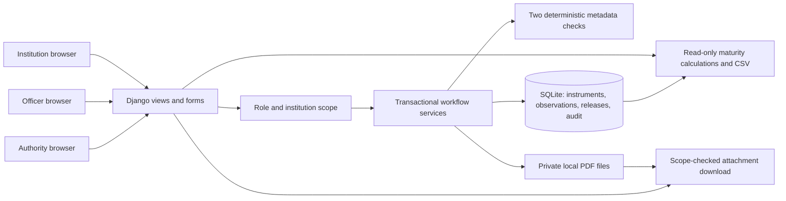

# Implemented architecture

This documents the existing FDR lifecycle MVP. It is not a proposal to add an AI pipeline or another service.

The frontend is Django templates and local CSS. There is no separate SPA, public JSON API, worker, AI model, OCR engine, bank connector, email provider or payment gateway. HTTP form endpoints are listed in `portal/urls.py`; session authentication is in `config/urls.py`.

`forms.py` validates required fields, positive two-decimal INR amounts, date order and upload envelopes. `uploads.py` checks extension, MIME, size, header and trailer; it does not parse a PDF. `permissions.py` denies missing/ambiguous roles, limits institutions to their own records, and hides private drafts from staff. No admin route is exposed.

`services.py` implements draft → submitted → corrections/resubmission → accepted-for-tracking, and observation creation/resolution. Rules in `validation.py` detect missing FDR-kind metadata and same-institution duplicate bank/reference pairs. Version technical-v2 uses Unicode casefold and whitespace trim consistently; prior audit snapshots retain their recorded rule version. Duplicate checks stream only institution-scoped bank/reference values; this is linear in that institution's records. A production index/normalization strategy would require scale evidence.

Officers manually inspect downloads and enter observations tied to a document and optional positive page number. Blocking observations require explicit officer resolution before acceptance. Page existence and the accuracy of a human's interpretation are not machine-verified. Acceptance is an administrative human action, not an authenticity determination.

Renewals use a one-to-one predecessor link. The predecessor remains current until successor acceptance, which supersedes it atomically. Release request → independent authority authorization/rejection → separate evidence-backed completion is implemented in `releases.py`. Authorization leaves monitoring active. Completion requires a new evidence PDF and removes the instrument from current monitoring. No money moves.

SQLite transactions, optimistic versions and database constraints protect supported state transitions. File writes are cleaned up on known transaction failures. This is not a distributed transaction: process termination between filesystem and database operations can still leave orphan files. Audit history is append-only through supported views, not tamper-proof against direct database access.

`middleware.py` converts database/storage exceptions raised by views into generic 503 responses after service rollback; it never automatically replays writes. Logs include the exception class, not SQL, paths, document text or request bodies. This does not cover all infrastructure failures, middleware/session-write failures, process crashes or disk cleanup failures. All responses receive no-store headers. Missing stored files return 404; workflow conflicts return 409; validation errors rerender forms; unauthorized actions use 403/404 or login redirects.

Data lives under ignored `data/`: SQLite, protected PDF files, local demo credentials and scenario manifest. Files have generated storage names, stored sizes and SHA-256 hashes. Every download re-hashes the stored file against the recorded SHA-256 and serves the checked copy; a mismatch is refused (409), written to the audit trail as `DOCUMENT_INTEGRITY_FAILED` and sent to officers. Hashes are not signatures or authentication. There is no application encryption at rest; confidentiality relies on local filesystem access for the synthetic demo.

`deadlines.py` powers dashboard, register filters, CSV and `due_actions`. Only accepted, non-superseded, non-released instruments enter current monitoring. CLI reports are for a trusted operator. Browser evaluation-date overrides are DEBUG-only and explicitly labeled; detail pages use the actual business date. There is no scheduler or notification delivery.

Operational tools build checksummed source/wheel ZIPs, install without a package index, seed synthetic workflows, exercise authenticated HTTP and evaluate a fixed synthetic contract in memory. Python 3.12 remains an external prerequisite. The deployment boundary is localhost, Django's development server and synthetic data; production hosting is not configured.
